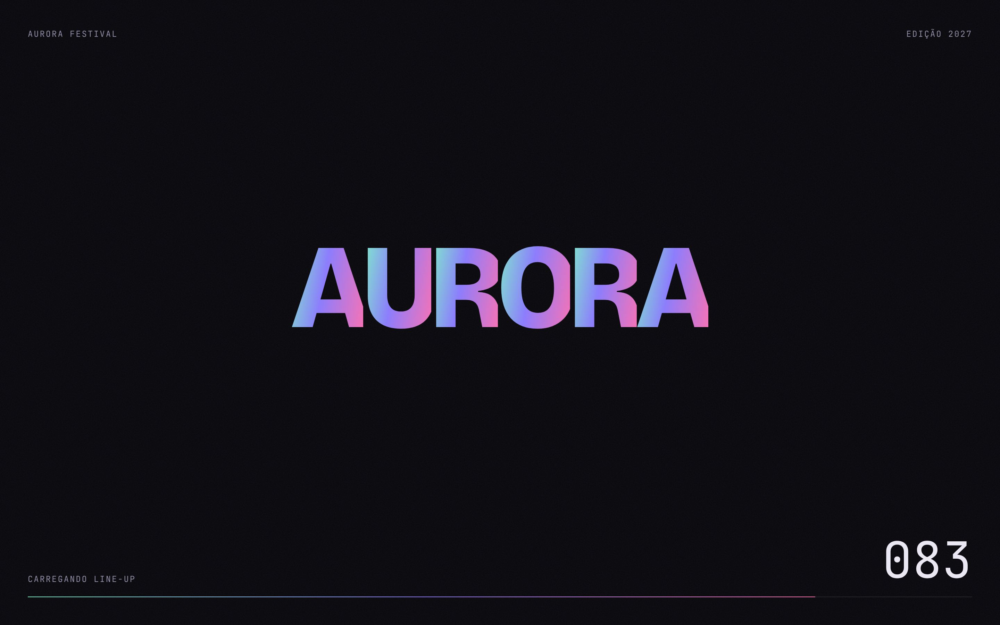

# Aurora Festival

Landing page for a **fictional** music festival, built to practice web animation with React. Artists, prices, and dates are all made up.


| Preloader | Past edition zoom parallax |
| :---: | :---: |
|  |  |
| **Line-up with cursor preview** | **3D tilt tickets** |
|  |  |

## Stack

- React 19 + TypeScript + Vite
- Tailwind CSS 4 (tokens in `@theme` inside `index.css`)
- [Motion](https://motion.dev) for animations
- [Lenis](https://lenis.darkroom.engineering) for smooth scrolling
- lucide-react for icons

## Animations

| Section | What happens | Where |
| :--- | :--- | :--- |
| Intro | 0 to 100 counter and curtain sliding up | `Preloader.tsx` |
| Full page | smooth scrolling (Lenis) and custom cursor with a ring that expands over links | `useSmoothScroll.ts`, `Cursor.tsx` |
| Hero | color blobs, twinkling stars, and a spotlight following the mouse | `AuroraBackground.tsx` |
| Hero | letters of "AURORA" rotate in 3D on entrance and the title tilts toward the mouse; on scroll, the block scales down and blurs | `Hero.tsx` |
| Headings | rise word by word as they enter the viewport | `RevealText.tsx` |
| Countdown | each digit swaps with `AnimatePresence` (`mode="popLayout"`) | `Countdown.tsx` |
| Buttons | magnetic effect with `useSpring` | `MagneticButton.tsx` |
| Artist marquee | speeds up with scroll velocity and reverses direction when scrolling up (`useVelocity`) | `VelocityMarquee.tsx` |
| Line-up | artist "cover" card follows the cursor (hover-capable devices only) | `Lineup.tsx` |
| Schedule | active tab pill slides smoothly with `layoutId` | `Schedule.tsx` |
| Stats | animated counters when scrolled into view | `Stats.tsx` |
| 2026 Edition | zoom parallax: seven "posters" scaling at different speeds until the center one fills the screen | `ZoomParallax.tsx` |
| Experience | sticky section: vertical scroll becomes horizontal movement | `Experience.tsx` |
| Tickets | 3D tilt with light glare reflection | `TiltCard.tsx` |
| Navbar | hides when scrolling down and reappears when scrolling up | `Navbar.tsx` |

Users with `prefers-reduced-motion` get the version without continuous motion (`useReducedMotion`).

The "photos" are stage illustrations built purely with gradients (`conic-gradient` for light beams) and a crowd silhouette SVG generated with a fixed seed (`StageArt.tsx`, `Crowd.tsx`), so the project does not depend on any external images.

Bugs worth noting:

- `RevealText` originally used `whileInView` on each word. Since every word starts 100% hidden by `overflow: hidden`, very short words never "entered the viewport" (the "é" in "Não é só show" disappeared). Detection was moved to the full heading instead.
- Horizontal scrolling in the experience section used a fixed `-62%`, which cut off the last card on mobile. The travel distance is now calculated from the track's `scrollWidth` using `ResizeObserver`.

## Running locally

```bash
npm install
npm run dev
```

Other scripts: `npm run build`, `npm run lint`, and `npm run preview`.

The workflow in `.github/workflows/deploy.yml` deploys to GitHub Pages on every push to `main` (enable it under **Settings → Pages → Source: GitHub Actions**).

## Structure

```text
src/
├── components/   # one section per file + reusable animation components
├── data/         # line-up, schedule, tickets, and FAQ
├── hooks/        # useCountdown
└── lib/          # wrap (used in the infinite marquee)
```
