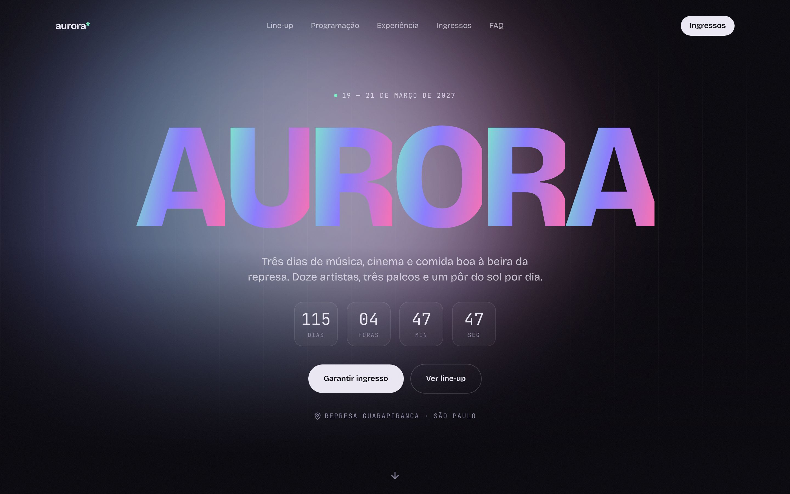
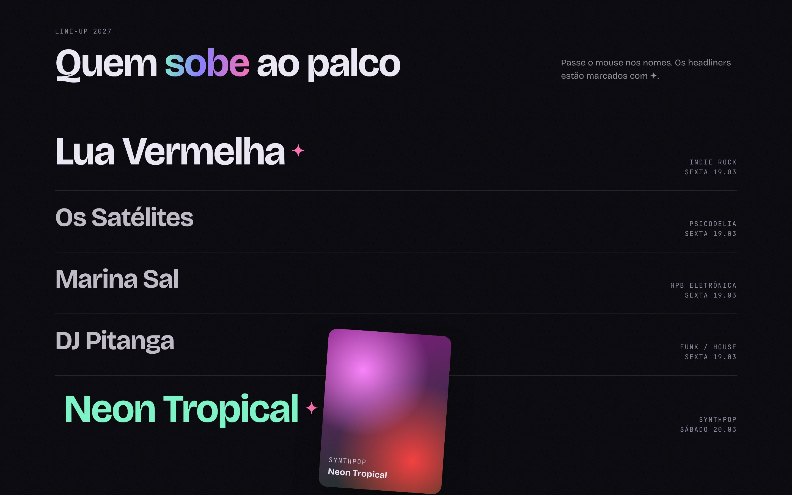

# Aurora Festival

Landing page de um festival de música **fictício**, feita pra praticar animação na web com React. Artistas, preços e datas são inventados.



| Line-up com preview no cursor | Ingressos com tilt 3D |
| :---: | :---: |
|  |  |

## Stack

- React 19 + TypeScript + Vite
- Tailwind CSS 4 (tokens no `@theme` do `index.css`)
- [Motion](https://motion.dev) pras animações
- lucide-react pros ícones

## Animações

| Seção | O que acontece | Onde |
| :--- | :--- | :--- |
| Hero | blobs de cor se movendo com blur + spotlight que segue o mouse | `AuroraBackground.tsx` |
| Hero | letras de "AURORA" sobem uma a uma; ao rolar, o bloco diminui e desfoca | `Hero.tsx` |
| Contagem regressiva | cada dígito troca com `AnimatePresence` (`mode="popLayout"`) | `Countdown.tsx` |
| Botões | efeito magnético com `useSpring` | `MagneticButton.tsx` |
| Faixa de artistas | acelera com a velocidade do scroll e inverte o sentido ao rolar pra cima (`useVelocity`) | `VelocityMarquee.tsx` |
| Line-up | card com a "capa" do artista segue o cursor (só em dispositivos com hover) | `Lineup.tsx` |
| Programação | a pílula da aba ativa desliza com `layoutId` | `Schedule.tsx` |
| Experiência | seção sticky: scroll vertical vira movimento horizontal | `Experience.tsx` |
| Ingressos | tilt 3D com reflexo de luz | `TiltCard.tsx` |
| Navbar | some ao rolar pra baixo e volta ao rolar pra cima | `Navbar.tsx` |

Quem usa `prefers-reduced-motion` recebe a versão sem os movimentos contínuos (`useReducedMotion`).

Uma coisa que precisei corrigir: o scroll horizontal da seção de experiência usava um `-62%` fixo, o que cortava o último card no celular. Agora a distância é calculada a partir do `scrollWidth` da trilha, com `ResizeObserver`.

## Rodando

```bash
npm install
npm run dev
```

Outros scripts: `npm run build`, `npm run lint` e `npm run preview`.

O workflow em `.github/workflows/deploy.yml` publica no GitHub Pages a cada push na `main` (é preciso ativar em **Settings → Pages → Source: GitHub Actions**).

## Estrutura

```text
src/
├── components/   # uma seção por arquivo + componentes de animação reutilizáveis
├── data/         # line-up, horários, ingressos e FAQ
├── hooks/        # useCountdown
└── lib/          # wrap (usado na faixa infinita)
```
