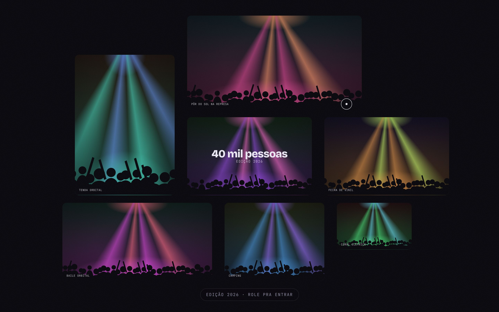

# Aurora Festival

Landing page de um festival de música **fictício**, feita pra praticar animação na web com React. Artistas, preços e datas são inventados.


| Preloader | Zoom parallax da edição passada |
| :---: | :---: |
|  |  |
| **Line-up com preview no cursor** | **Ingressos com tilt 3D** |
|  |  |

## Stack

- React 19 + TypeScript + Vite
- Tailwind CSS 4 (tokens no `@theme` do `index.css`)
- [Motion](https://motion.dev) pras animações
- [Lenis](https://lenis.darkroom.engineering) pro scroll suave
- lucide-react pros ícones

## Animações

| Seção | O que acontece | Onde |
| :--- | :--- | :--- |
| Entrada | contador de 0 a 100 e cortina abrindo pra cima | `Preloader.tsx` |
| Página toda | scroll suave (Lenis) e cursor customizado com anel que cresce em links | `useSmoothScroll.ts`, `Cursor.tsx` |
| Hero | blobs de cor, estrelas piscando e spotlight que segue o mouse | `AuroraBackground.tsx` |
| Hero | letras de "AURORA" giram em 3D na entrada e o título inclina na direção do mouse; ao rolar, o bloco diminui e desfoca | `Hero.tsx` |
| Títulos | sobem palavra por palavra quando entram na tela | `RevealText.tsx` |
| Contagem regressiva | cada dígito troca com `AnimatePresence` (`mode="popLayout"`) | `Countdown.tsx` |
| Botões | efeito magnético com `useSpring` | `MagneticButton.tsx` |
| Faixa de artistas | acelera com a velocidade do scroll e inverte o sentido ao rolar pra cima (`useVelocity`) | `VelocityMarquee.tsx` |
| Line-up | card com a "capa" do artista segue o cursor (só em dispositivos com hover) | `Lineup.tsx` |
| Programação | a pílula da aba ativa desliza com `layoutId` | `Schedule.tsx` |
| Números | contadores animados quando aparecem | `Stats.tsx` |
| Edição 2026 | zoom parallax: sete "pôsteres" que escalam em velocidades diferentes até o central ocupar a tela | `ZoomParallax.tsx` |
| Experiência | seção sticky: scroll vertical vira movimento horizontal | `Experience.tsx` |
| Ingressos | tilt 3D com reflexo de luz | `TiltCard.tsx` |
| Navbar | some ao rolar pra baixo e volta ao rolar pra cima | `Navbar.tsx` |

Quem usa `prefers-reduced-motion` recebe a versão sem os movimentos contínuos (`useReducedMotion`).

As "fotos" são ilustrações de palco feitas só com gradientes (`conic-gradient` pros feixes de luz) e uma silhueta de público em SVG gerada com seed fixa (`StageArt.tsx`, `Crowd.tsx`), então o projeto não depende de nenhuma imagem externa.

Bugs que valeram a pena registrar:

- O `RevealText` usava `whileInView` em cada palavra. Como cada palavra começa 100% escondida pelo `overflow: hidden`, palavras curtas nunca "entravam na tela" (o "é" de "Não é só show" sumia). A detecção passou para o título inteiro.
- O scroll horizontal da seção de experiência usava um `-62%` fixo, o que cortava o último card no celular. Agora a distância é calculada a partir do `scrollWidth` da trilha, com `ResizeObserver`.

## Rodando

```bash
npm install
npm run dev
```

Outros scripts: `npm run build`, `npm run lint` e `npm run preview`.

O workflow em `.github/workflows/deploy.yml` publica no GitHub Pages a cada push na `main` (é preciso ativar em **Settings → Pages → Source: GitHub Actions**).

## Estrutura

```text
src/
├── components/   # uma seção por arquivo + componentes de animação reutilizáveis
├── data/         # line-up, horários, ingressos e FAQ
├── hooks/        # useCountdown
└── lib/          # wrap (usado na faixa infinita)
```
